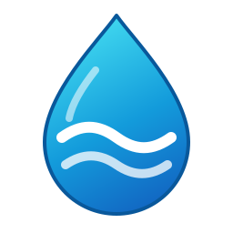

# TGN Voda для Home Assistant

[](https://github.com/hacs/integration)
[](https://github.com/Nikita-28-07/ha-tgn-voda/actions/workflows/tests.yaml)



Интеграция получает данные из личного кабинета МУП «Управление „Водоканал“» г. Таганрога: начисления, оплату и показания счётчиков. Также доступны сервисы для истории и передачи новых показаний.

## Установка

Требуется Home Assistant версии **2026.8.0** или новее.

В HACS откройте **Integrations → Custom repositories**, добавьте URL репозитория `https://github.com/Nikita-28-07/ha-tgn-voda` с категорией **Integration**, затем установите **TGN Voda** и перезапустите Home Assistant.

Без HACS скопируйте каталог `custom_components/tgn_voda` в каталог `custom_components` вашей установки и перезапустите Home Assistant.

## Настройка

Откройте **Настройки → Устройства и службы → Добавить интеграцию → TGN Voda** и укажите логин, пароль и номер лицевого счёта. Параметры URL и проверки сертификата можно оставить по умолчанию. Для нескольких лицевых счетов добавьте отдельную запись интеграции для каждого.

Интеграция создаёт устройство лицевого счёта и дочерние устройства счётчиков. Доступны сенсоры начислений и баланса, признак задолженности, последнее показание и кнопка обновления. Список сущностей зависит от данных, возвращаемых порталом.

### Изменение параметров

В параметрах интеграции доступны адрес портала, проверка TLS-сертификата, путь к собственному CA bundle и интервал обновления в секундах. По умолчанию данные обновляются каждые **1800 секунд**; минимальный интервал — **60 секунд**. После сохранения параметров интеграция перезагружается. Кнопка обновления на устройстве лицевого счёта запрашивает данные вручную.

Логин, пароль и лицевой счёт можно изменить через **Перенастроить** в меню записи интеграции. При истечении авторизации Home Assistant предлагает повторно ввести пароль. Один лицевой счёт нельзя добавить дважды.

## Сервисы

Сервисы истории публикуют результат событием Home Assistant. Можно выбрать устройство лицевого счёта в `device_id`; если настроено несколько лицевых счетов, укажите устройство или `entry_id`.

```yaml
service: tgn_voda.get_history
data:
  device_id: "DEVICE_ID_ACCOUNT"
  date_from: "01.10.2026"
  date_to: "31.10.2026"
```

Событие `tgn_voda_history` содержит `items` и `entry_id`. Аналогично работают `get_payments_history`, `get_accruals_history` и `get_accruals_detalization` (для последнего укажите `month`, например `01.10.2026`). Сервис `get_counter_info` принимает ID счётчика либо его устройство и публикует событие `tgn_voda_counter_info`.

| Сервис `tgn_voda.*` | Параметры | Событие с результатом |
| --- | --- | --- |
| `get_history` | `date_from`, `date_to` в формате `ДД.ММ.ГГГГ` | `tgn_voda_history`: `items`, `entry_id` |
| `get_payments_history` | `date_from`, `date_to` в формате `ДД.ММ.ГГГГ` | `tgn_voda_payments`: `items`, `entry_id` |
| `get_accruals_history` | `date_from`, `date_to` в формате `ДД.ММ.ГГГГ` | `tgn_voda_accruals`: `items`, `entry_id` |
| `get_accruals_detalization` | `month`, например `01.10.2026` | `tgn_voda_accruals_detalization`: `items`, `month`, `entry_id` |
| `get_counter_info` | `counter_id` или `device_id` устройства счётчика | `tgn_voda_counter_info`: `counter`, `entry_id` |
| `submit_readings` | `readings`: словарь ID счётчиков и показаний | После успешной отправки обновляет данные интеграции |

Каждый сервис также принимает `entry_id` или `device_id` для выбора записи интеграции. При единственной настроенной записи выбор можно опустить. При совместном указании идентификаторы должны относиться к одной записи, а `counter_id` — соответствовать выбранному устройству счётчика.

### Сведения о счётчике

```yaml
action: tgn_voda.get_counter_info
data:
  device_id: "DEVICE_ID_METER"
```

В **Инструменты разработчика → События** включите прослушивание `tgn_voda_counter_info` перед вызовом. Поле `counter` содержит только следующие сведения (значения приведены для примера):

```json
{
  "meter_type": "НОРМА СВКМ",
  "digit_capacity": 6.0,
  "tariff_count": 1.0,
  "transformation_coefficient": 1.0,
  "verification_date": "2023-02-01",
  "next_verification_date": "2029-02-01"
}
```

Передача показаний выполняется через `submit_readings`:

```yaml
service: tgn_voda.submit_readings
data:
  device_id: "DEVICE_ID_ACCOUNT"
  readings:
    "484441": 123.45
```

Используйте фактические ID устройств и счётчиков из вашей установки. Отправленные показания являются операцией на портале и должны соответствовать данным прибора.

## Примеры автоматизаций

Готовые YAML-примеры доступны в каталоге [`automation/`](automation/): [отправка показания](automation/submit_readings.yaml), [уведомление о задолженности](automation/notify_about_debt.yaml) и [получение сведений о счётчике](automation/get_counter_info.yaml). Ниже `DEVICE_ID_ACCOUNT`, entity ID и ID счётчика — примеры. Подставьте значения из своей установки и создайте helper `input_number.water_meter_484441` для показания.

Для примера получения сведений создайте helper `input_button.get_water_meter_info` и замените `DEVICE_ID_METER` на ID устройства счётчика. Результат можно прослушать как событие `tgn_voda_counter_info`.

### Отправить вручную введённое показание по нажатию кнопки

Создайте helper `input_button.submit_water_reading`, внесите в `input_number` показание с прибора и нажмите кнопку:

```yaml
alias: Submit water meter reading
triggers:
  - trigger: state
    entity_id: input_button.submit_water_reading
actions:
  - action: tgn_voda.submit_readings
    data:
      device_id: "DEVICE_ID_ACCOUNT"
      readings:
        "484441": "{{ states('input_number.water_meter_484441') | float }}"
mode: single
```

### Создать уведомление о задолженности

```yaml
alias: Notify about water debt
triggers:
  - trigger: state
    entity_id: binary_sensor.tgn_voda_has_debt
    to: "on"
actions:
  - action: persistent_notification.create
    data:
      title: TGN Voda
      message: "К оплате: {{ states('sensor.tgn_voda_to_pay_now') }} ₽"
mode: single
```

Проверьте фактические entity ID в Home Assistant: суффиксы могут зависеть от номера лицевого счёта.

## Диагностика

В меню записи интеграции можно скачать диагностику: параметры подключения, статус и время последнего успешного обновления, данные портала. Логин, пароль, контактные данные, адрес, ФИО и идентификаторы счетов и счётчиков скрываются.

При ошибке авторизации используйте предложенную Home Assistant повторную авторизацию. При ошибке соединения проверьте доступность портала и параметры подключения. Для отчёта об ошибке приложите диагностику и соответствующие записи журнала; раздел [Issues](https://github.com/Nikita-28-07/ha-tgn-voda/issues) доступен в репозитории.

## Разработка

Требуется Python 3.12 или новее. CI проверяет API на Python 3.12–3.14, а Home Assistant integration suite — на Python 3.14 с минимальным HA 2026.8.0 и актуальным HA.

HA-тесты запускайте на Linux (в CI или WSL): тестовый плагин Home Assistant использует Unix-модули, недоступные в обычном Windows Python.

Установите API-тестовые зависимости командой `python -m pip install -r requirements-test.txt`. Для HA-интеграционных тестов используйте `python -m pip install -r requirements-ha-test.txt`.

Для проверки минимального HA установите зависимости с ограничением версии плагина: `python -m pip install -r requirements-ha-test.txt pytest-homeassistant-custom-component==0.13.354`.

Проверка стиля: `ruff check custom_components tests` и `ruff format --check custom_components tests`.

API и metadata-тесты запускаются командой `pytest tests/test_api.py tests/test_metadata.py`. Полный набор автоматических тестов запускается командой `pytest tests/test_api.py tests/test_metadata.py tests/test_integration.py`. Live-тесты портала выполняются отдельно командой `pytest tests/test_live_portal.py` и требуют локальный файл конфигурации с доступом к аккаунту. CI запускает автоматические тесты, hassfest и проверку HACS.

См. [CHANGELOG.md](CHANGELOG.md) для списка изменений.

Проект распространяется под лицензией [MIT](LICENSE).
